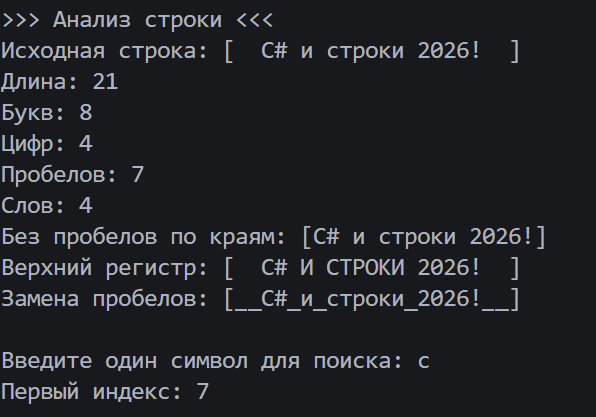

# Практическая работа №19

Автор: Сахабутдинова Екатерина
Группа: ИСП-252

## Тема

Строки в C#.

## Что реализовано

- определение длины строки;
- подсчёт букв, цифр, пробелов и слов;
- поиск первого индекса символа;
- удаление пробелов по краям;
- перевод в верхний регистр;
- замена пробелов на подчёркивания.

## Короткие ответы

1. Чем отличаются `string` и `char`?

Ответ: string - хранит строку, записывается в двойных кавычках, char - хранит символ, записывается в одинарных кавычках

2. Почему вызов `text.Trim()` без сохранения результата не меняет `text`?

Ответ: строки - это неизменяемый тип данных, их методы возвращают новую строку, не меняя изначальную

3. Зачем при разделении строки используется `RemoveEmptyEntries`?

Ответ: RemoveEmptyEntries автоматически удаляет из списка пустые элементы 

## Результат

